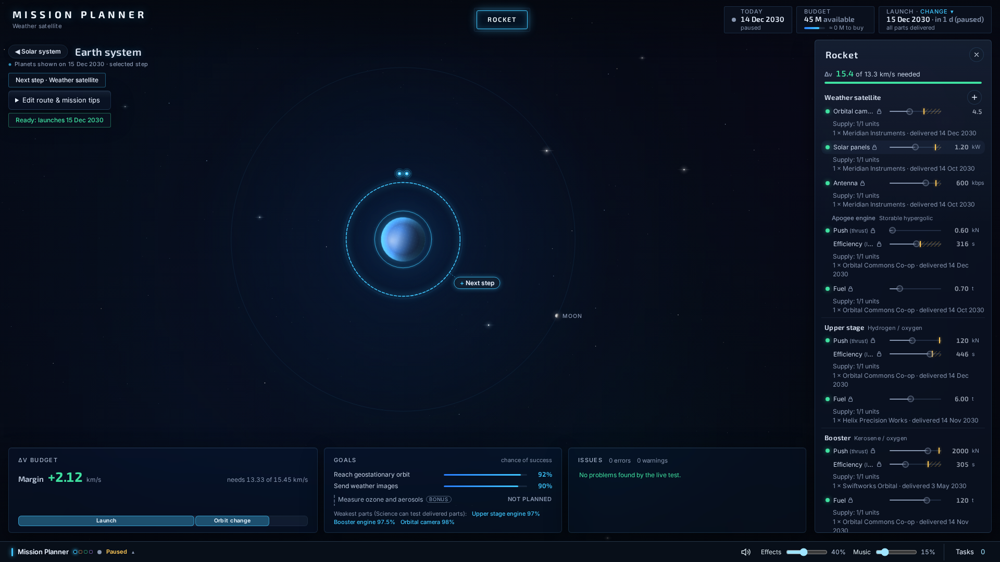

# T-Minus

A cooperative browser game about delivering a space mission. Plan a trajectory, buy equipment, develop and test hardware, and manage partnerships while sharing one budget and launch schedule.

**[Play T-Minus](https://missioncontrol.dractec.com/)** · **[Watch the 29.5-second trailer](https://missioncontrol.dractec.com/submission/)** · [Source repository](https://github.com/XDracam/spaceappschallenge2026)

Designed for four players at separate desktop stations: Mission Planning, Procurement, Science and Communications. Fewer players can switch to unclaimed stations. The current source contains **Weather satellite**, **Lunar ice lander**, and **Mars orbiter + lander**. Start with Weather.



*An actual capture from the trailer production, retained as a visual reference.*

Built for the [2026 NASA Space Apps Space Mission Design Game challenge](https://www.spaceappschallenge.org/2026/challenges/space-mission-design-game/). The user confirmed submission on November 16, 2026; the actual submission date, external receipt and submitted source commit are not established here. See the [submission artifact reference](docs/submission-reference.md).

## First session

1. The host chooses **New game**, a mission and a station, then shares the room code or invite link. Other players join and claim free stations before the host starts.
2. Planning builds the route and publishes part needs. Procurement compares supplier offers and delivery schedules. Science develops missing capabilities, arranges facilities through Procurement and tests delivered hardware. Communications handles messages and partnerships.
3. Use shared **Tasks** and **Open work** to find cross-role work. Talk through trade-offs while each station acts on the same mission.
4. Watch delivery, research and test dates. Launch happens at the planned date; Planning can move it when recovery needs more time, subject to the mission deadline.
5. Inspect the goal-by-goal outcome. The host can retry with a fresh attempt or choose another mission without disbanding the session.

The public PeerJS broker handles room setup; a public TURN relay supports connections that cannot be direct. If room codes fail, the host can expand **Manual codes** and exchange one invite/reply pair per player. Verify your actual network before a demonstration.

The host's browser attempts local saves. **Continue** restores a successful save; players then rejoin. Manual connections need fresh codes. Keep the host tab visible because browser background throttling can slow the calendar. Use the station menu to pause during explanations.

## Run locally

Install Node.js and npm; the deployment configuration selects Node 20. From the repository root:

```bash
cd game
npm ci
npm run dev
```

Open the printed address. To check and inspect a production build:

```bash
npm run typecheck
npm run build
npm run preview
```

These are existing compiler/build commands, not a test suite. [Contributor guidance and architecture](docs/current-prototype.md#working-on-the-game) explain ownership and verification. Changes to `game/` on `main` trigger the [Pages workflow](.github/workflows/pages.yml).

## About the prototype

The game uses TypeScript, Preact, Canvas and Vite, with host-authoritative WebRTC sessions. Mission content is authored in advance; no generative AI runs during play. Models and fictional suppliers, prices and events are deliberate game abstractions, not operational mission-planning tools. Human learning outcomes, multiplayer enjoyment and sustained engagement remain unvalidated by the agent walkthroughs.

The human team created the concept and designed the gameplay. All original project code was AI-generated by OpenAI Codex and Anthropic Claude under the team's direction; project images were generated with ChatGPT Images, and supporting content/documentation were AI-generated. [Full AI acknowledgement and tools](docs/ai-and-submission.md) and [third-party credits](THIRD_PARTY.md) retain provenance and external authorship.

The JPL paper [*Space Mission Concept Development Using Concept Maturity Levels*](https://dataverse.jpl.nasa.gov/dataset.xhtml?persistentId=hdl:2014/44299) informed the design. This is conceptual resource use, not NASA observational-data integration or a formal NASA maturity assessment. See the [source review](docs/reviews/2026-11-14-cml-paper.md).

- [Current prototype](docs/current-prototype.md): implemented flow, roles and remaining design questions.
- [Documentation index](docs/README.md): current references, decisions, history and verification records.
- [Post-submission audit](docs/reviews/2026-11-16-post-submission-audit.md): findings and evidence before the finishing pass.

## License

Original project material is [Apache 2.0](LICENSE), except where separate notices apply. Third-party libraries, fonts, icons and audio retain their own licenses; see [THIRD_PARTY.md](THIRD_PARTY.md). Full notices and the project license ship with the game as [THIRD_PARTY_NOTICES.txt](game/public/THIRD_PARTY_NOTICES.txt) and [LICENSE.txt](game/public/LICENSE.txt). No rights to NASA branding or endorsement are implied.
