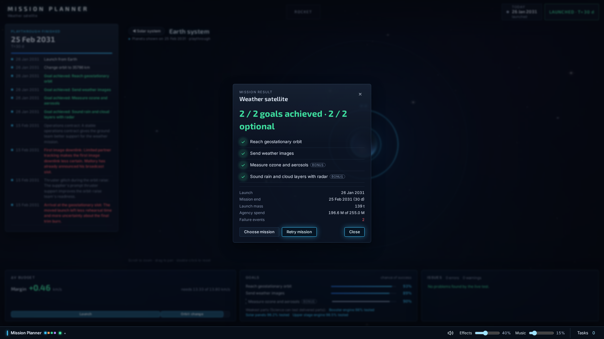
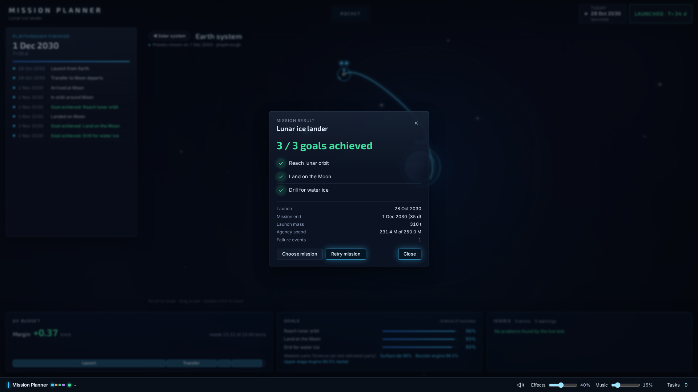
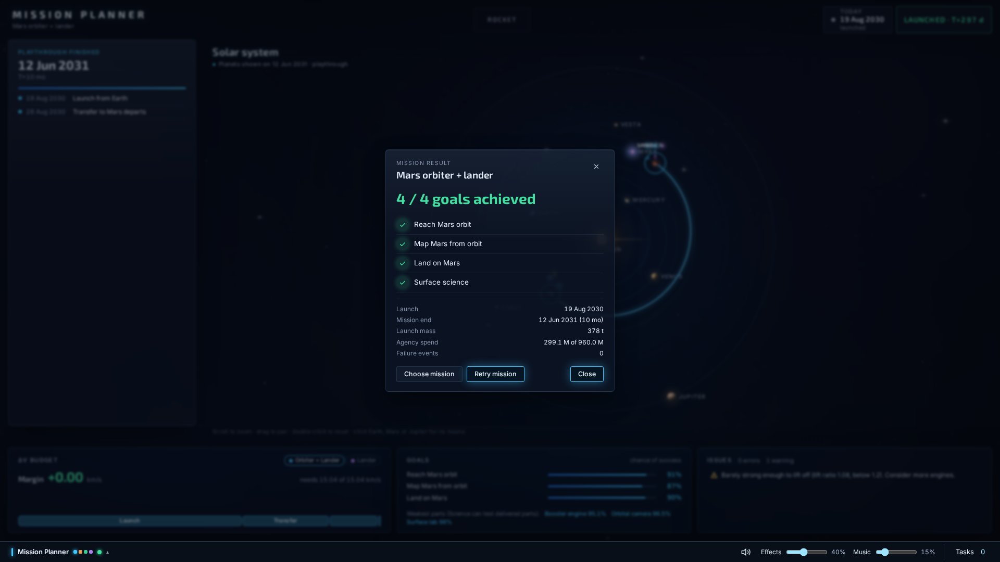

# Mission feasibility and four-station verification — November 16, 2026

## Result

**All three current missions have now completed through four genuinely connected browser stations, with every required goal achieved. Weather also achieved both optional goals. One actual research-failure recovery per mission was replayed successfully through the same four-station topology.**

No game code, balance values, missions or submitted media changed during this confidence pass. The [recorded game input fingerprint](../reviews/2026-11-16-post-submission-implementation/source-fingerprint.json) still matches: `cd2bb5e9464918e54666be2d271a542cd4c36c8a607b5255d12b4cbced85ce07`. This is the already audited working candidate; it is not a claim about a historical submitted source revision.

[Network summary](2026-11-16-mission-confidence/network-summary.json) · [Independent review](2026-11-16-mission-confidence/reports/independent-review.md) · [Previous finishing-pass verification](2026-11-16-post-submission-verification.md).

## Setup and method

- Status: completed verification, not a human enjoyment playtest.
- Source: user asked “then get more confident” after being told that Moon/Mars and Weather optional goals lacked current end-to-end evidence.
- Participants: agent-operated Chromium 151.0.7922.34, headless Linux, four isolated browser contexts at 1920×1080. Planning hosted; Procurement, Science and Communications connected through real manual invite/reply WebRTC data channels and each held its own seat. These are four software stations on one computer, not four physical venue machines.
- Seed: 20261116 declared for all three main recipes before executing them. Fixed batch: every seed 20261116 through 20261125 for each mission, with all outcomes retained. Recovery representatives come from actual failures in that declared batch; they are explicitly separate policy follow-ups, not replacement wins or a hidden lucky-seed search.
- Initialization: the normal fresh-game seed was fixed in isolated browser setup, including the normal transient Back-to-start reset. The resulting mission/seed was checked before play. No post-initialization shared-state patch, fabricated money, unlocked technology, forced research success, reliability edit or debug event was used.
- Route planning: specialists used current source/evaluator/quotation functions to find feasible normal decisions. All chosen Planner values fit normal UI ranges and all maneuver kinds are exposed by the game. These are informed facilitator recipes, not blind first-time-player attempts.
- Execution: the browser for each role invoked its existing typed action dispatcher; clients passed through the real host ownership/validation/ordered replication path. This exercises the real actions and network, not a complete mouse-click sequence for every control. Setup, briefings, result skip, Retry and Choose mission controls were also operated through their actual UI.
- Calendar: paused and advanced in authored day boundaries through the existing host clock action; no instantaneous delivery/research completion. Original costs, project durations, deadlines, random research rolls, event choices and delivery dates ran normally. Pausing/stepping removes human input-speed pressure from this verification.
- Synchronization: host-confirmed full-state hashes were compared across all four contexts after every role-action group; consecutive daily ticks were batched by at most 20. Final full results were compared too. A recorded `walkthroughCompleted` means the driver finished; mission success is separately derived from actual goal outcomes and scrub status.
- Evidence retention: seven network records, six replay recipes, all seed-batch summaries, source-derived procurement checks, specialist reports, independent review and three real final screenshots are retained under [the evidence directory](2026-11-16-mission-confidence/network-summary.json). No new test suite was added; these were calculations and scripted browser walkthroughs requested for this verification.

## Completed main routes

All amounts in M. Funding includes ordinary authored Communications effects, including cuts/gains. No free budget was injected.

| Mission / seed | Actual goals | Launch day | Last achieved goal day / deadline | Spend / available funding | Remaining |
| --- | --- | --- | --- | --- | --- |
| Weather / 20261116 | 2/2 required + 2/2 optional | 390 | 390.219 / 400 | 196.6 / 255 | 58.4 |
| Moon / 20261116 | 3/3 | 300 | 304.978 / 455 | 231.4 / 250 | 18.6 |
| Mars / 20261116 | 4/4 | 230 | 497 / 1277 | 299.1 / 960 | 660.9 |

Every route had all contracted hardware delivered, a nonnegative final budget, no evaluator errors, no page exceptions and identical confirmed states/results on all four stations. Mars retained its truthful low-lift-ratio warning (1.08, below the suggested 1.2); it still lifts off under the existing model.

- **Weather:** add spectrometer performance 5 and radar performance 3; research Larger sensor arrays, Ka-band downlink and Radar electronics using the two existing teams. Buy the actual catalogue supply against the published requirements. The supplied tank sizes provide the needed fuel; solar/data capacity covers all instruments. All eleven parts were delivered and tested, final tests finished by day 374.24, and launch 390 reached GEO before day 400. Spend 196.6 is below the original 210 starting allocation even without counting later gains.
- **Moon:** use one 4500kN kerolox booster, normal 22t upper tank and 1.6t descent tank, the 4.5 surface lab and 2.5t legs. Research Hypergolic injector tuning and Lab automation. Contracted supply—not draft estimates—was used in evaluation. Ten hardware parts were delivered and eight tested. Launch to low Earth orbit, transfer to the Moon, insert at 100km and land. Funding fell to 250 through a real Treasury cut; the solution still fits.
- **Mars:** request upper tank 23t (catalogue supplies 80t), orbiter tank 2t (4t supplied), lander tank 0.8t (1.6t supplied) and lander antenna 200kbps (600kbps supplied). Research the camera capability. Launch 230, transfer depart 239/travel 258, capture at 1000km, release the lander and land. All sixteen contracts arrived by day 213.

Detailed spoiler/reference recipes: [Weather](2026-11-16-mission-confidence/reports/weather.md), [Moon](2026-11-16-mission-confidence/reports/moon.md), [Mars](2026-11-16-mission-confidence/reports/mars.md). The network JSONs retain exact normal actions and actual contracts; they are the authoritative replay observations.

## Research-failure recoveries actually replayed with four stations

| Mission / fixed seed | Actual setback and normal response | Goal completion / deadline | Actual result | Spend / funding |
| --- | --- | --- | --- | --- |
| Weather / 20261117 | Radar research failed at day 132. Retried; Comms ran Storm Night gala and Feldwerk deal, repeating the ordinary gala until Industry was strictly above 70. Its existing lead-time benefit let the radar signed at 217 arrive at 382; late optional test was skipped. | 390.219 / 400 | 2/2 required + 2/2 optional | 207.7 / 255 |
| Moon / 20261120 | Lab research failed. Instead of paying for repeated failed retries, Comms bought the existing Northgate regolith partnership; its normal grant enabled the lab. Procurement bought/expedited the lab and Planning moved launch to 398. | 402.978 / 455 | 3/3 | 250.4 / 272 |
| Mars / 20261118 | First camera research failed. Science paid for/retried it, Procurement bought the camera after success, and Planning used the later transfer window: launch/depart 1017, travel 252. | 1269 / 1277 | 4/4 | 315.2 / 1005 |

These are real recovery routes in the current game; no rules were changed to make them work. Weather and Mars recovery timing is tight, so these observations do not imply that every further delay remains recoverable.

## Fixed-seed calculations, including retained failures

These are pure normal-reducer simulations, distinct from the six four-browser completions above. Ten seed values per mission are a small fixed scenario set, not an estimate of a population win probability.

| Mission / policy | Complete wins in ten seed cases | What the other cases establish |
| --- | --- | --- |
| Weather, initial cheap/test policy | 7/10 all four goals | Two radar-retry schedules missed procurement timing and scrubbed; one lost hardware reliability. These original failures remain retained. |
| Weather, existing Industry recovery after radar failure | 8/10 all four goals | All ten cases had eleven delivered parts, no evaluator errors and spend at or below the original 210M. Two still lost goals to component reliability: apogee tank and solar panels. |
| Moon, initial research-retry policy | 7/10 all three goals | Two legitimate component losses; one case exhausted the retry/timing policy after four Lab automation failures. That case is the separately demonstrated successful partnership recovery above. |
| Mars, camera retry/later-window policy | 9/10 all four goals | Every case had a feasible funded route; one lost surface science to a real lab-component failure. |

The correction here is to the **verification policy**, not to gameplay. In particular, repeatedly buying the same failed research and keeping a late delivery schedule is not evidence that a mission is impossible. The existing partnership, supplier relations, delivery amendments and launch-window choices matter. Conversely, a physically feasible plan is not proof of hardware delivery or a successful random outcome, so those are recorded separately.

Raw calculation records: [Weather initial](2026-11-16-mission-confidence/calculations/weather-initial-policy.json), [Weather recovery policy](2026-11-16-mission-confidence/calculations/weather-industry-recovery-policy.json), [independent Weather procurement check](2026-11-16-mission-confidence/calculations/weather-procurement-check.json), [Moon initial](2026-11-16-mission-confidence/calculations/moon-initial-policy.json), [Moon targeted partnership recovery](2026-11-16-mission-confidence/calculations/moon-partnership-recovery.json), [Mars](2026-11-16-mission-confidence/calculations/mars-with-retries.json).

## Connected-session recovery

A separate four-station run completed Mars, pressed **Retry mission**, and observed attempt 2 with the previous outcome recorded once and all four seats/connections preserved. After an ordinary empty-plan scrub, **Choose mission** returned the group to the lobby; choosing Moon and starting reopened every actual station view with the same four seats and connections. Full states converged, all four local station IDs were correct after UI effects completed, and no page/sync error occurred. This verifies session recovery; it is not counted as another completed Moon mission. [Flow record](2026-11-16-mission-confidence/network/session-flow.json).

## Screenshots

These are actual final Planner screens from the connected runs, not generated mockups or edited submission footage.

## Interpretation and remaining limits

Confidence in **functional solvability of all three current missions is now high**, with concrete budgets, acquired hardware, deadlines, normal stochastic resolutions and four-station state convergence. Normal failure/recovery paths also worked. No structural blocker or audit regression was found in these routes; no gameplay change was needed.

This does not promise a win for every seed or sequence of player decisions. Testing parts reduces failure risk rather than removing it. “Mission end” in the playback includes a 30-day display tail; feasibility deadlines apply to actual goal events, so the later tail is not misreported as a deadline failure or used to hide a late goal. The game’s simplified numerical model is the authority for this prototype, not operational spaceflight validation.

Human first-time discoverability, click-only completion of every action, pacing while the calendar runs continuously, enjoyment/concurrent engagement, four physical networks and venue/TURN behavior remain unmeasured. The programmatic actions were checked to be normally obtainable through the UI, but an informed action recipe is not a substitute for observing people learn the game.

No commit, push or deployment occurred. Browser contexts and the isolated verification server were closed afterward.
