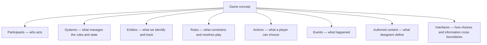

# Concept taxonomy

Assistant proposal, November 14, 2026. Procurement names are selected in D-006. This taxonomy organizes the broader brainstorm for discussion. It describes gameplay concepts and their relationships. Implementation boundaries remain open.

## Overview

## How the categories connect

A Player takes a Role and uses an Interface to choose an Action. A System applies Rules to Entities and records resulting Events. Systems use Authored content and exchange messages through Interfaces.

For example, the procurement player accepts an Offer. Procurement checks the Budget, creates a Contract, and reports that it was signed. Shared state records the resulting commitment. Procurement discusses its implications with planning. Which details planning can inspect remains open.

These categories describe purpose and relationships. An identifiable Resource definition belongs among the Entities and is also Authored content. A named astronaut can be a world actor and a procured Resource, depending on the personnel model selected. These connections should be explicit in designs.

A Role expresses player responsibility. A System applies rules and manages state. Procurement is currently the name of both a Role and a System. Role switching and shared ownership remain open.

An event definition describes a possible situation and its outcomes. An event occurrence records a particular situation happening during play. A system message carries state or an event to another system. For example, an authored funding-dispute situation can lead to a particular funding cut, communicated through `FundingChanged`.

## Participants

Who plays, takes responsibility, or acts in the world?

| Concept | Meaning | Example |
| --- | --- | --- |
| Player | A human participating in a session. | You or a teammate. |
| Role | A responsibility a player takes on. | Procurement, planning, science, communications. Switching remains an idea. |
| World actor | A person or organization inside the fiction. | Supplier, politician, sponsor, astronaut, researcher. Personnel representation remains open. |

## Systems

Which rules manage state and resolve actions?

| Concept | Meaning | Example |
| --- | --- | --- |
| Procurement | Handles acquisition and its commitments. | Calls, Offers, Contracts, Allocations, Budget. |
| Mission planning | Configures and evaluates the mission. | Payload, trajectories, constraints, launch windows. |
| Science | Runs research and develops capabilities. | Researcher assignments, project progress, unlocks. |
| Communications | Resolves external interactions and relationships. | Dialogue choices, stakeholder demands, opportunities. |
| Shared Tasks | Tracks goals and evaluates evidence across roles. | AND/OR criteria and completion. |
| Scenario and time | Advances scenario state and applies authored triggers. | Time reaches a deadline and a due event takes effect. |
| Personnel · candidate | Could handle qualification, training, growth, and availability. | A researcher gains a skill. Boundary and model open. |

## Entities

What do we identify and track?

| Concept | Meaning | Example |
| --- | --- | --- |
| Task | A goal with completion criteria. | One engine with thrust ≥ 12 kN by tick 80. |
| Resource | A definition of a part, person, or service that can be supplied. | The E12 engine model and its properties. |
| Call | An invitation for Offers addressing a Task. | Ask suppliers for an engine meeting that need. |
| Offer | Supplier terms for a Resource. | One E12 for 30 credits, lead time 20 ticks. |
| Contract | An accepted Offer and the commitment it creates. | Signed at tick 10, delivery expected at tick 30. |
| Allocation | Contracted quantity reserved for a Task criterion. | Reserve that engine for the flight engine Task. |
| Budget | Funding, spending, commitments, and available funds. | 100 funded, 20 spent, 30 committed, 50 available. |
| Mission, project, progression | Candidate state records for other parts of the game. | A lunar mission, a research project, campaign progress. Shapes open. |

## Rules

What constrains a choice or determines its result?

| Concept | Meaning | Example |
| --- | --- | --- |
| Property | A typed attribute, with a unit where applicable. | Engine thrust is 12 kN; a person has a qualification. |
| Constraint | A limit that a proposed solution must respect. | Total payload mass at most 200 kg. |
| Completion criterion | A condition evaluated to determine Task completion. | One qualifying engine is available by the need-by time. |
| Dependency and duration | What must happen first and how long work takes. | Assembly starts after delivery and takes 10 ticks. |
| Resolution rule | How an action or uncertainty produces a result. | Cancellation settlement, research failure, reliability effects. Details open. |
| Difficulty | Parameters that could alter demands or pressure. | Time pressure or budget limits. Controls remain ideas. |

## Actions

What can a player choose to do?

| Concept | Meaning | Example |
| --- | --- | --- |
| Create or revise Task | Express or change a goal. | Planning raises the required engine thrust. |
| Open Call | Invite supplier Offers. | Seek a custom engine solution. |
| Accept Offer | Commit to its terms. | Sign an engine Contract. |
| Allocate or release | Assign or free contracted quantity. | Reserve one computer for the science lab. |
| Cancel Contract | End a commitment under its terms. | Pay the agreed cancellation cost. |
| Assign research or respond to dialogue | Act through another gameplay system. | Staff a research project or accept a sponsor's conditions. |

## Events

What happened, and what changed as a result?

| Concept | Meaning | Example |
| --- | --- | --- |
| External occurrence | An outside situation with possible consequences. | A politician demands an extra payload. |
| Action outcome | A recorded result of a choice. | Contract C1 was signed. |
| Timed outcome | A result of time advancing under the scenario rules. | A delivery arrived or a Call closed. |
| State change | A specific effect on tracked state. | Funding fell by 20 credits; delivery moved to tick 90. |
| Research outcome | The completion or failure of a project. | A lighter sensor became accessible. Resolution remains open. |

## Authored content

What do designers hand-craft for the systems to use?

| Concept | Meaning | Example |
| --- | --- | --- |
| Scenario definition | Initial conditions, goals, and possible developments. | A lunar mission with starting funds and authored events. |
| Resource and supplier definitions | The things and organizations available in the scenario. | Engine models, people, services, suppliers. |
| Offer content | The available procurement terms and possible responses. | Catalogue Offers and authored Call responses. |
| Event and dialogue definitions | Situations, choices, conditions, and effects. | A funding dispute with several responses. |
| Project and rule definitions | Research options and authored parameters. | Sensor research, risk profiles, cancellation terms. |

## Interfaces

How do players and systems exchange information and choices?

| Concept | Meaning | Example |
| --- | --- | --- |
| Player view | A presentation of relevant state. | Task board, catalogue, Contract list, mission configurator. |
| Player control | A way to express an Action. | Accept Offer button, researcher assignment, dialogue option. |
| System input | A specific message consumed by another system. | FundingChanged with amountDelta and causeId. |
| System output | Published state or evidence for other systems. | TaskAssessmentChanged with Task revision, gaps, and allocations. |

## Scope and unresolved placements

- Shared Tasks and scenario/time are proposed shared systems. Personnel is a candidate whose representation remains open.
- Suppliers and stakeholders are world actors represented by authored content and runtime interactions.
- Research projects and relationship projects are proposed work entities managed by science and communications respectively. Their mechanics remain brainstorming.
- Missions are candidates for played scenario state. Campaigns or roguelite runs could organize several missions and retain progression. Neither structure is selected.
- Planning simulations and final mission resolution are rules and activities whose relationship remains open under Q-008.
- The authored-content baseline is D-005. Runtime selection, combination, and player-created tasks remain open under Q-026.
- The procurement prototype lives separately in `procurement/`. This taxonomy provides vocabulary for eventual integration.

See the [concept](concept.md), [decisions](decisions.md), [roles](design/roles.md), and [procurement interfaces](../procurement/interfaces.md).
